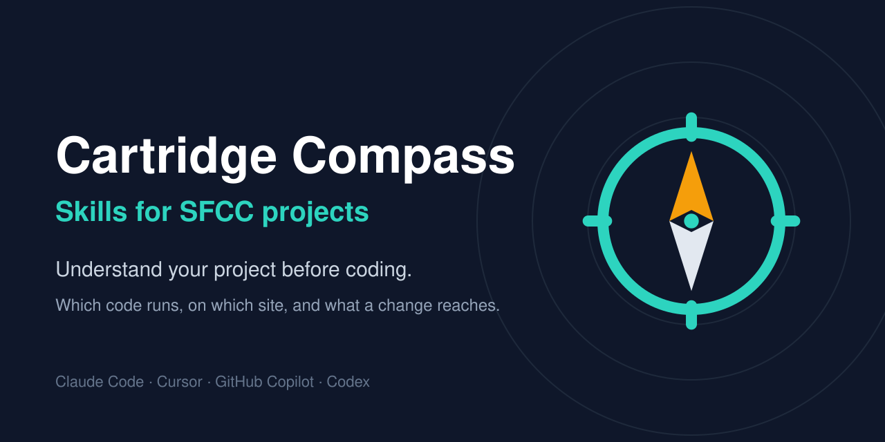
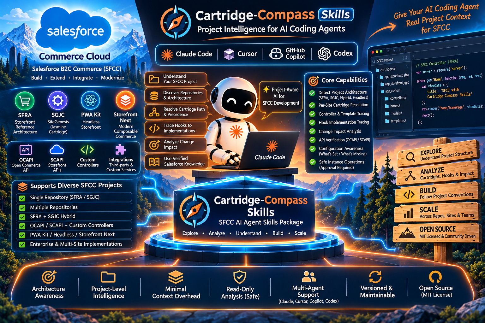
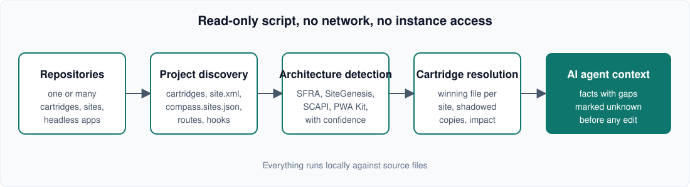
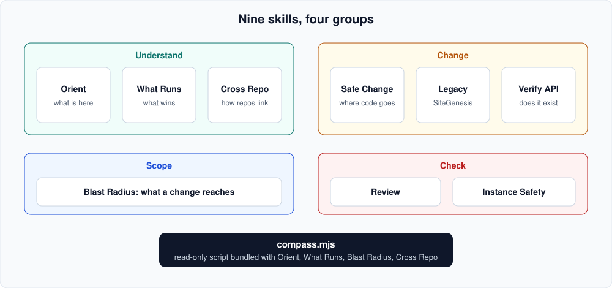
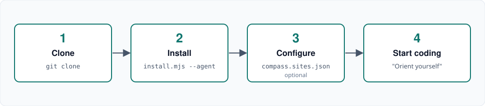
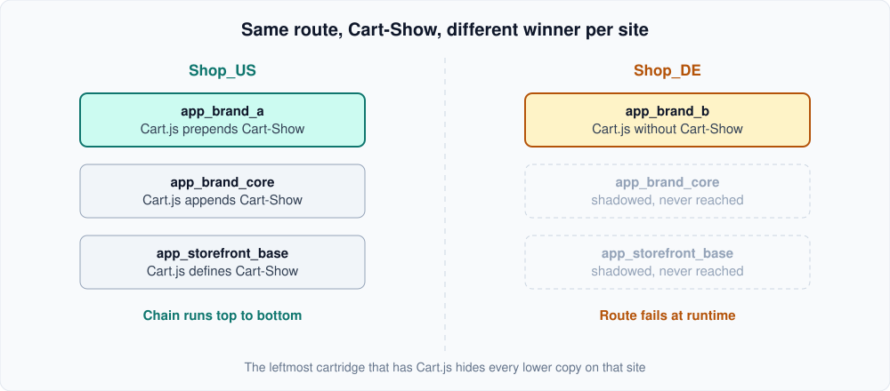

<p align="center">
  
</p>

# Cartridge Compass Skills

**Cartridge Compass Skills**: agent skills that help AI coding agents work correctly in Salesforce B2C Commerce (SFCC) projects. Works with Claude Code, Cursor, GitHub Copilot and Codex.

[](https://github.com/gauravkr-io/cartridge-compass-skills/actions/workflows/ci.yml)
[](LICENSE.txt)


AI coding agents know SFCC in general. They do not know which copy of `Cart.js` runs on your UK site, which of your repositories owns a cartridge, or which sites a change to a shared helper reaches. These skills give an agent a method and a tool for exactly those questions, and the discipline to say "unknown" when the project does not tell it.

They complement Salesforce's official [B2C Developer Tooling](https://github.com/SalesforceCommerceCloud/b2c-developer-tooling). The official skills teach the platform and trace one cartridge path. These skills cover many sites at once, several repositories, change impact and legacy code.



## How it works



## The problem it solves

Agents make the same SFCC mistakes again and again:

- editing a controller that never runs, because a cartridge further left on the site path wins
- changing a shared cartridge without knowing it reaches every brand
- assuming one hook runs, when every registered implementation runs in path order
- applying SFRA patterns to SiteGenesis code
- inventing APIs, hooks, endpoints or cartridge paths
- treating the repository they are in as the whole system
- deploying or changing an instance without being asked

Each skill below exists to stop one of these.

## What you get

| Skill | The question it answers |
|---|---|
| `sfcc-orient` | What is this project? Which repositories, which architectures, which sites, what is not configured |
| `sfcc-what-runs` | Which controller chain, template, script or hook actually runs, on which site |
| `sfcc-blast-radius` | Which sites does this change reach, and what depends on the file |
| `sfcc-safe-change` | Where does the code go, which SFRA pattern, how to validate |
| `sfcc-legacy` | How to change SiteGenesis controllers and pipelines, and prove legacy code is unreachable before removing it |
| `sfcc-verify-api` | Does this API, hook or endpoint exist, and is it current |
| `sfcc-cross-repo` | How do several repositories, and a headless storefront, fit together |
| `sfcc-review` | Does this change contain an SFCC-specific mistake |
| `sfcc-instance-safety` | What may be run against an instance without asking |



Four of the skills bundle `compass.mjs`, a read-only script with no dependencies. It resolves these questions for every site at once and groups the sites that share an answer.

## Quick start

Requirements: Node.js 18.17 or newer and an agent that reads the [Agent Skills](https://agentskills.io/) format.

```bash
git clone https://github.com/gauravkr-io/cartridge-compass-skills.git
cd /path/to/your/sfcc/project
node /path/to/cartridge-compass-skills/install.mjs --agent claude
```

| Agent | Flag | Installs into |
|---|---|---|
| Claude Code | `--agent claude` | `.claude/skills/` |
| Cursor | `--agent cursor` | `.cursor/skills/` |
| GitHub Copilot | `--agent copilot` | `.github/skills/` |
| Codex and others | `--agent agents` | `.agents/skills/` |

Install into one folder per project. Cursor and Copilot also read `.claude/skills/`, so a team that mixes agents can run `--agent claude` once.

Start a new agent session and ask: *"Orient yourself in this SFCC project."*



Nothing else is required. The full walkthrough is in [SETUP.md](SETUP.md).

## Tell it about your sites

Without cartridge paths the skills still work and say that precedence is unknown. For per-site answers, add `compass.sites.json` to the project root:

```json
{
  "sites": [
    { "id": "Shop_US", "cartridgePath": "app_custom_shop:app_core:app_storefront_base" },
    { "id": "Shop_UK", "cartridgePath": "app_custom_uk:app_custom_shop:app_core:app_storefront_base" }
  ]
}
```

Site import data with `sites/<id>/site.xml` in a repository is picked up automatically. So is `docs/ai/site-map.json` from the open-source [Cartridge Compass](https://github.com/gauravkr-io/cartridge-compass) kit.

## See it work

```bash
node .claude/skills/sfcc-what-runs/scripts/compass.mjs resolve --route Cart-Show --root .
```

```text
## Shop_US, Shop_UK
Result: chain
1. app_brand_a          controllers/Cart.js  [sfra]  prepend (line 4)  extends the next file
2. app_brand_core       controllers/Cart.js  [sfra]  append (line 4)   extends the next file
3. app_storefront_base  controllers/Cart.js  [sfra]  get (line 3)

## Shop_DE
Result: error at runtime
1. app_brand_b          controllers/Cart.js  [sfra]  does not define this action
Never reached (shadowed copies): app_brand_core, app_storefront_base
```



One command shows that the German site has a `Cart.js` that hides every lower route. An agent that edits the first `Cart.js` it finds would never see this.

## Supported architectures

| Kind | Covered |
|---|---|
| Cartridge storefronts | SFRA, SiteGenesis controllers (SGJC), pipelines, classic controllers, and any mix |
| APIs | SCAPI custom APIs, hooks on `dw.ocapi.*` extension points, OCAPI deprecation guidance |
| Headless | PWA Kit and Storefront Next, linked to the cartridges they depend on |
| Project shapes | One repository or many, one site or many, shared and brand cartridges |

## Script commands

| Command | Output |
|---|---|
| `overview` | Repositories, detected architecture with confidence, cartridges missing locally, gaps |
| `sites` | Site list and cartridges shared by every site. `--export <id>` prints one path |
| `resolve --route Cart-Show` | The controller chain per site |
| `resolve --template checkout/cart` | Which template wins per site |
| `resolve --file scripts/x.js` | Which copy of a script or model wins, and whether lower copies still run |
| `hooks --point <name>` | Registrations in cartridge path order per site |
| `impact <file>` | Sites reached, status per site, and what depends on the file |

Add `--json` for structured output, `--site A,B` to limit sites, `--path a:b:c` to test one path.

## How the agent uses it

1. The agent loads only each skill's name and description at startup, about 100 tokens per skill.
2. When a task matches, it reads that skill's instructions, about 1,000 to 1,300 tokens.
3. It runs the bundled script for facts and reads a reference file only when needed.
4. With Salesforce's `b2c project` command installed, `sfcc-what-runs` feeds it each site's path for a deeper trace.

## Safe by design

- The script reads source files only. It never writes.
- It never reads `dw.json`, `.env` files, keys or certificates.
- It never contacts an instance or the network.
- The installer copies skill folders and never overwrites a skill it did not install.
- No dependencies.

Details: [SECURITY.md](SECURITY.md).

## Limits

Static analysis sees local code. It does not see computed route or template names, code loaded with `importScript`, Business Manager configuration, content on the instance, or repositories that were not scanned. Every answer says so. Skills guide an agent, and an agent can still be wrong. Review changes before they ship.

## Documentation

| Guide | For |
|---|---|
| [SETUP.md](SETUP.md) | Installing and configuring, step by step |
| [docs/ARCHITECTURE.md](docs/ARCHITECTURE.md) | How it is built and why |
| [docs/TROUBLESHOOTING.md](docs/TROUBLESHOOTING.md) | Common problems and fixes |
| [docs/UPGRADING.md](docs/UPGRADING.md) | Versions and updates |
| [CHANGELOG.md](CHANGELOG.md) | What changed in each release |

## Updates

```bash
git -C /path/to/cartridge-compass-skills pull
node /path/to/cartridge-compass-skills/install.mjs --agent claude
```

Running the installer again replaces the installed skills with the new version.

## Roadmap

- Hook return-value analysis in the script
- Pipeline start nodes in route resolution
- Published before-and-after evaluation results on real projects
- Dedicated guidance for Storefront Next migrations

## Contributing

Bug reports and suggestions are welcome. Read [CONTRIBUTING.md](CONTRIBUTING.md) first.

## License and trademarks

Commercial license. All rights reserved. See [LICENSE.txt](LICENSE.txt). Viewing the source does not grant a license. Copies obtained while version 1.0.1 was published under the MIT license keep those terms.

Not affiliated with or endorsed by Salesforce or Anthropic. Salesforce, Commerce Cloud and Claude are trademarks of their respective owners.
